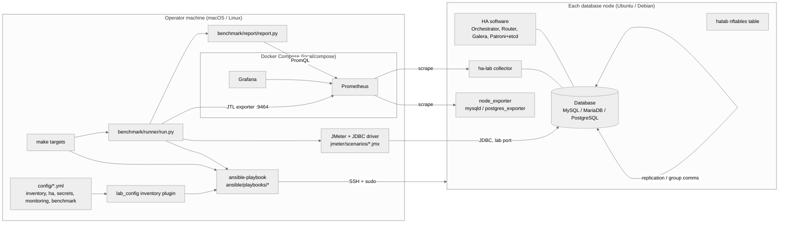
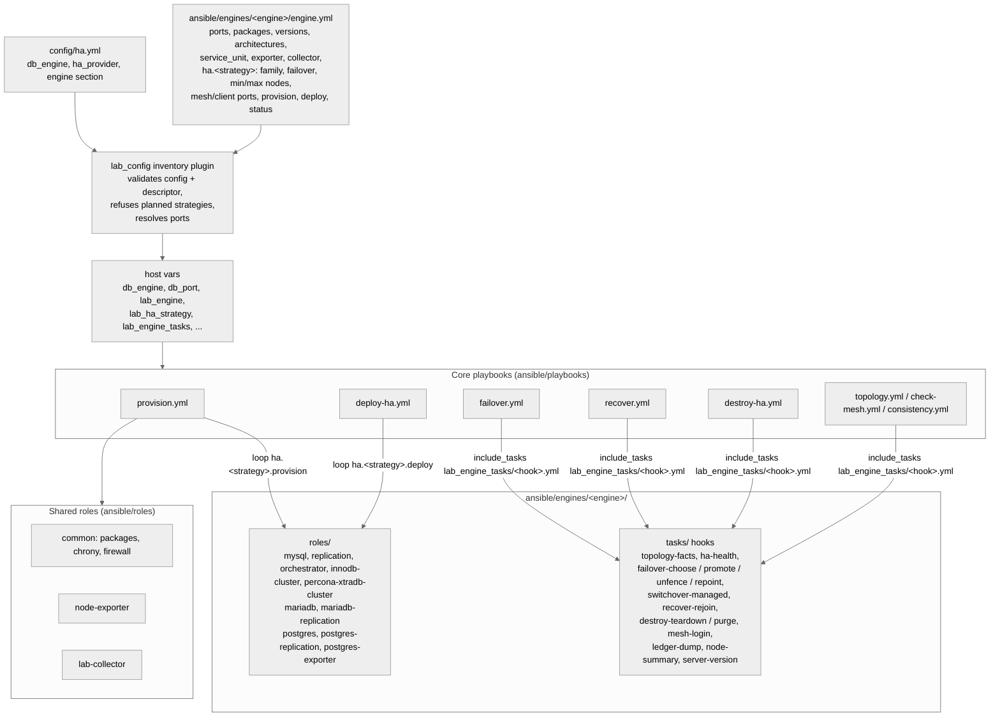
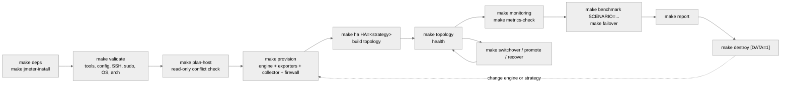
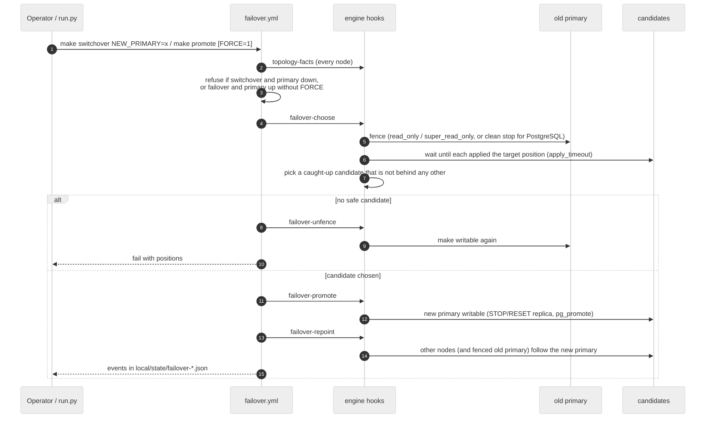
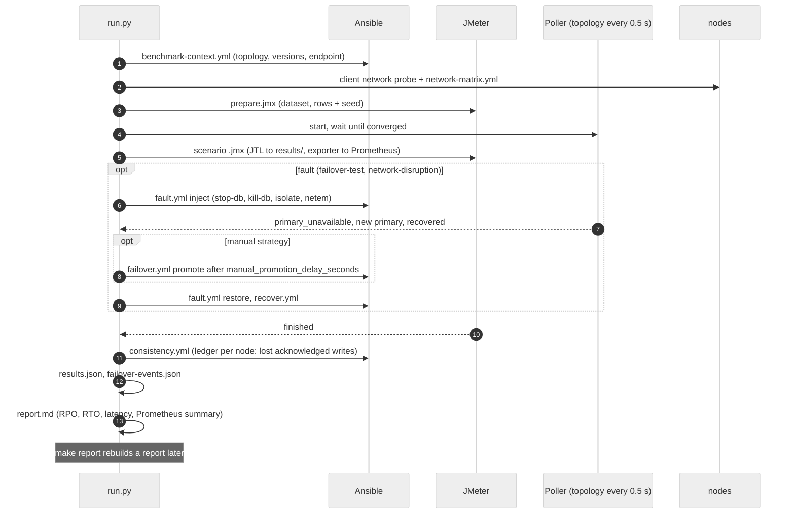

# Diagrams

Mermaid diagrams (GitHub renders them inline), neutral grey theme. Names match files in the repo.

## 1. Components

What runs where. The operator's machine drives everything; nodes only run the database stack.

## 2. Engine abstraction

The core never names a database. It reads the engine descriptor and calls hooks by name.

## 3. Lab lifecycle

## 4. Manual failover (async-replication, semi-sync, streaming, sync)

`failover.yml -e failover_mode=switchover|failover`. Strategies with an HA manager (Orchestrator, InnoDB Cluster, Galera) go to `switchover-managed` instead.

## 5. Benchmark run

`make benchmark SCENARIO=...` and `make failover` both run `benchmark/runner/run.py`.

